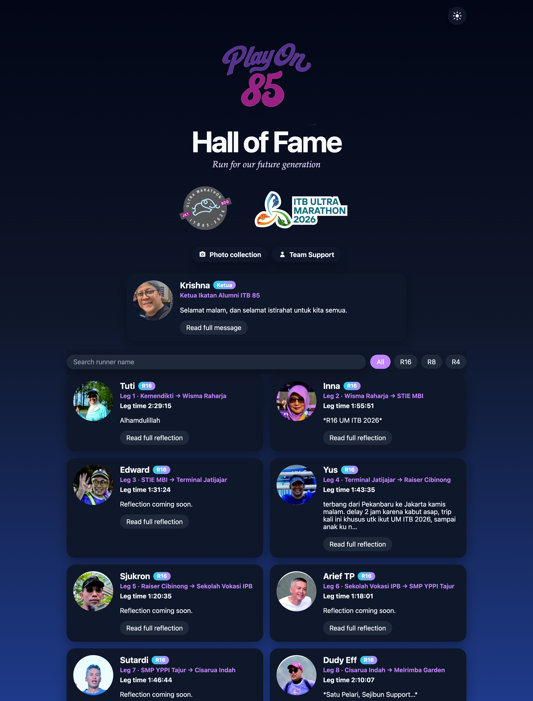
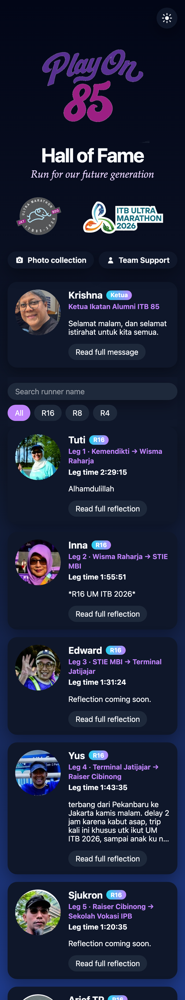

# PlayOn 85 Hall of Fame

Post-race Hall of Fame for the PlayOn 85 team at ITB Ultra Marathon 2026 (Jakarta–Bandung).

Plain HTML, CSS, and JavaScript site for GitHub Pages.

## Page

Desktop



Mobile



## Layout

```
index.html
favicon.ico                browser tab icon
css/styles.css
js/app.js                  roster, search, theme, Ketua, and Team Support
js/theme.js                applies the saved theme, or dark mode, before paint
data/runners.json          published roster, including reflections
data/runners.local.json    optional local copy, this machine only
assets/favicon.png         browser tab icon, PNG fallback
assets/og.png              image shown when the link is shared
assets/photos/             runner and Team Support portraits
assets/logos/              official logos
```

The page uses `data/runners.local.json` when that file is present, and otherwise `data/runners.json`. Both can contain reflections. The published roster is `data/runners.json`.

## Using the page

- Filter by All, R16, R8, R4, or TS, and search by name. The two work together. All searches runners and Team Support. A race filter searches that category. TS searches Team Support.
- Each runner card shows the leg, the leg time, and a link to that runner's Strava profile. Athmam's card also has a Captain chip.
- The card shows a short reflection title. Open it to read the full note. Notes pasted from WhatsApp keep their bold headings and paragraph breaks. Sjukron's title is Pengalaman Ultra Marathon ITB 2026.
- Hendi's leg is 1:47:32 and Arief H's is 1:54:20. CP11 was not recorded, so those two times share the official gap from Luluk's finish to Arief H's finish, split by leg distance.
- Open a reflection to read it full screen. The text scrolls, and Close returns to the cards. Tuti, Triyani, Asrul, and Hariyono also show their album photos there. Each thumbnail opens that photo in the team album. The round portrait on the card stays as it is.
- On a phone, scroll down and an arrow at the bottom right returns to the top.
- Krishna and Hariyono sit side by side above the roster. Hariyono's title is chief of the mission, taken from Krishna's message. Krishna is also listed with Team Support.
- Team Support is its own group. Each card shows the role and the stretch they covered. Krishna, Asrul, Mira, Prima, Asep, Yos, Mpie, Affan, Yoyon, Novarini, Dudus, Hariyono, Syah, Sakir, and Wicak have photos. Wicak rode a motorcycle from start to finish. Yos drove from the start to WS-4 Cibinong. His title is Cerita Ku : Jadi Team Support Playon85 di UMITB 2026 — Rencana yang Berubah-ubah.
- The moon and sun button switches light and dark. The page opens in dark mode. A choice is saved in this browser.
- The browser tab shows a bold 85. Sharing the page link shows the full PlayOn 85 logo.
- Photo collection opens the team album: https://photos.google.com/share/AF1QipMrbWnA-2rNb946OTYhvqC97MzYFHCpqN8AE-5Za4WM5RB3uDpt90uer45ys8_08w?key=by11SEhXLWQ5aEgzaXFYdTRGb0FQQ2RIMlhncFdB
- The footer links to Race result R4, Race result R8, and Race result R16. The credit is © Prima - 2026 and opens https://primayuda.dev/

## Preview

```bash
python3 -m http.server 8080
```

Open `http://127.0.0.1:8080/`.

The published site is `https://primayuda.github.io/halloffameplayon/`.
